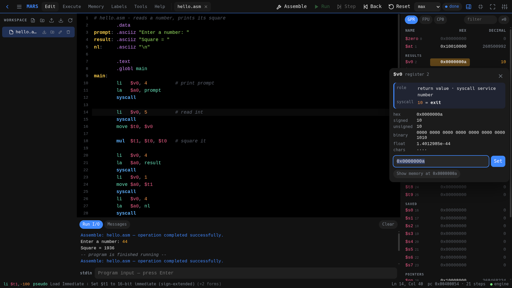
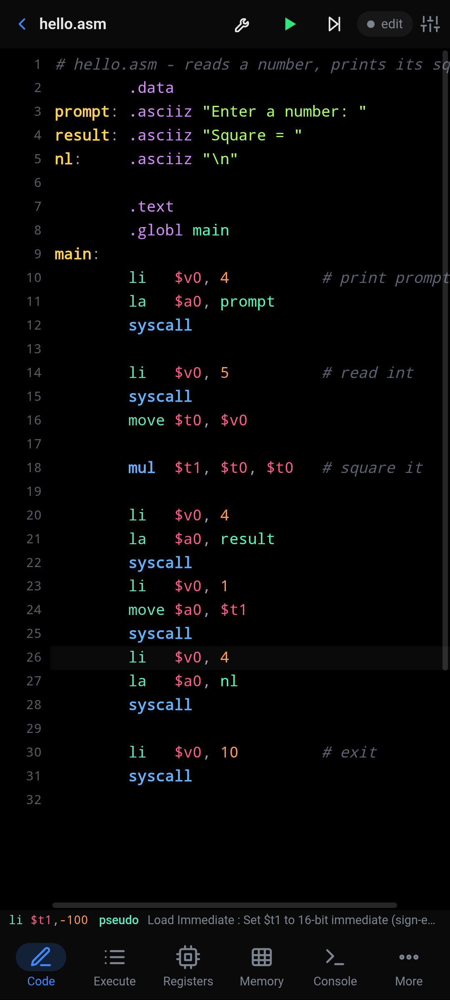
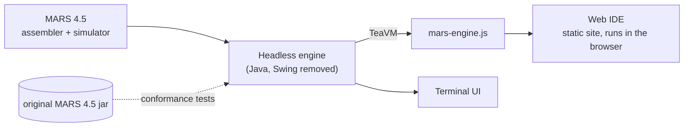

# MARS IDE

**MARS — the MIPS Assembler and Runtime Simulator — reworked for the browser, with a terminal UI too.**

**Try it: <https://franticplant.github.io/mars-ide/>** (runs entirely in your browser, works offline)

<p align="center">
  
  
</p>

MARS IDE puts the real MARS 4.5 assembler and simulator behind modern front ends:

- **In the browser:** the engine is compiled to JavaScript and runs in a Web Worker. There is
  no server: the site is plain static files, works offline, and keeps your files in the
  browser. Phones are first-class, with a touch layout and an editing key row above the keyboard.
- **In the terminal:** a keyboard-driven TUI, comfortable over SSH and in phone terminals.
- **Same results as MARS:** assembling and running are done by MARS's own code, and a
  conformance suite checks output, errors, instruction counts, registers and memory against the
  original MARS 4.5 jar.

It has a code editor with MIPS syntax highlighting, hints and completion, plus breakpoints,
step and step-back, and register, memory and label views. The Bitmap Display and
Keyboard/Display MMIO tools are included, along with dialog and MIDI syscalls, a searchable
MIPS reference card, and themes (including AMOLED black).

The browser also supports [split editor groups and rich Markdown previews](docs/web-workspace.md),
including Mermaid diagrams, highlighted code, tables, task lists and local images. Drag tabs
between panes, or use the group menu on touchscreens. Zen preserves your pane arrangement;
maximize a pane separately when you need to focus. Previews run in an isolated sandbox and
remote images are opt-in.

### Credits

MARS was created by **Pete Sanderson** and **Kenneth Vollmar** (Missouri State University) and is
MIT-licensed: <https://dpetersanderson.github.io/>. This repository is a fork of
[dpetersanderson/MARS](https://github.com/dpetersanderson/MARS) so that it shows up among the
project's forks. The code here is a full rewrite of the front ends; MARS's simulator is used
through `engine/patch_core.py`, which patches the MARS 4.5 sources, so its behaviour stays MARS's
own. MARS IDE is independent and not affiliated with or endorsed by the MARS authors. See
[THIRD_PARTY_NOTICES.md](THIRD_PARTY_NOTICES.md).

### How it fits together



More detail in [docs/architecture.md](docs/architecture.md).

## Quick start

Needs `podman` (rootless is fine), `make`, `python3` and `git`; everything else is built in
containers. Build on a laptop or desktop, not on a phone: the phone only runs the result.

```sh
git clone https://github.com/franticplant/mars-ide.git && cd mars-ide
make tui      # terminal IDE on ~/mars-workspace   (first run builds the image, a few minutes)
make web      # web IDE on http://127.0.0.1:8080  (prints a URL with an access token)
make static   # server-less static build on http://127.0.0.1:8081
make          # every target
```
`scripts/spawn.sh tui|web|static` does the same on the current directory and also works with
docker for published images (`MARS_IMAGE=…`). Everything is published on `127.0.0.1` only;
`BIND=0.0.0.0` exposes it to your network, so use that only on a trusted one.

Already have the image? Run it directly:
```sh
# terminal IDE on files in the current directory
podman run --rm -it --user 0:0 --cap-drop=ALL --security-opt=no-new-privileges -v "$PWD":/work:z mars-ide:latest

# web IDE — prints a URL with an access token; open it once per browser
podman run --rm --user 0:0 -p 127.0.0.1:8080:8080 --cap-drop=ALL --security-opt=no-new-privileges -v "$PWD":/work:z mars-ide:latest web
```
An empty `/work` is seeded with the example programs. Settings live in `/work/.mars-tui`.
Set `MARS_WEB_TOKEN=…` to choose the token, or pass `web --no-auth` on trusted networks only.

Phone (arm64): `build/mars-ide-arm64.tar` → `podman load -i mars-ide-arm64.tar`.
Without containers (e.g. Termux): needs Python 3.10+ and Java 11+ —
`PYTHONPATH=build/pylib:. python -m mars_tui` (or `… -m mars_tui web`).

## Screen space first

Both UIs are built to give the code as much room as possible, and every piece of chrome can be hidden:

| | TUI | Web |
|---|---|---|
| Editing | one top row + code + one status line | top bar + group tabs + code + status |
| Registers/console while editing | hidden; appear on run/step/input — **ctrl+j** toggles, **Esc** hides | same — **Ctrl+J** / **Esc**, panel button |
| Zen mode | **F10**: only code (Esc exits) | **F10** or ⤢ button: hide chrome, preserve editor groups |
| Optional chrome | ☰ menu → Layout: status line, line numbers, machine-code column | Settings → Layout: status bar, line numbers, key row, sidebar |
| Phones | one view at a time, ☰ menu (F4 / ctrl+e) has every action | bottom nav hides while typing; symbol key row (✕ to hide) |

## Reference card

`MIPS_Reference.pdf` is built in as a searchable **Card** tab in Help (both UIs): instructions with
operation, format and opcode/funct (tap for the bit encoding), pseudo-instructions, R/I/J formats,
registers, syscall codes, exception causes. **F1** (or tapping the hint bar) looks up the instruction
under the cursor; the hint bar shows its card semantics while you type. The web UI links the original
PDF if you supply it: the PDF itself is not in this repository (see
[docs/building.md](docs/building.md#reference-card)). Data lives in `tools/gen_refcard.py` →
`mars_tui/refcard.json` + `web/js/refcard.js`.

## Phones (web UI)

The app always fits the area above the on-screen keyboard (also in fullscreen). While typing, an
editing key row sits on the keyboard: hide-keyboard, indent/dedent, cursor ←→↑↓ (hold to repeat),
line start/end, MIPS symbols, comment toggle, undo/redo. **Aa** cycles key size, **⇕** switches
one scrolling row / two full rows, **✕** hides it (More › Key row brings it back).

## Keys (both UIs)

F3 assemble · F5 run / pause · F7 step · F8 step back · F9 pause · Shift+F12 reset ·
F10 zen · ctrl+j panels · ctrl+s save · Tab accepts completion · click/tap the gutter or ● for breakpoints.
TUI extras: F4/ctrl+e/☰ menu, ctrl+p command palette, F1 help, F2 settings. Ctrl alternatives:
ctrl+b assemble, ctrl+r run, ctrl+t step, ctrl+g back, ctrl+l reset.
Web: F11 toggles fullscreen, Shift+F11 stops execution. TUI: F11 stops execution.
On wide web layouts, the separate console and registers buttons in the top bar hide or
show either panel independently; the combined panels button / Ctrl+J still toggles both.

Web: Settings → **Emacs basic navigation** enables the core movement keys. It deliberately
does **not** take over browser keys such as paste or page navigation.

| Keys | Action |
|---|---|
| `C-f` / `C-b` | forward / backward character |
| `C-n` / `C-p` | next / previous line |
| `C-a` / `C-e` | beginning / end of line |
| `M-f` / `M-b` | forward / backward word |
| `M-<` / `M->` | beginning / end of buffer |
| `M-g g` | go to line |
| `C-F8` / `F4` | toggle a breakpoint at the cursor |

Breakpoints do not require line numbers: turning line numbers off leaves a narrow
breakpoint strip, and `Ctrl+F8` or `F4` toggles the breakpoint on the cursor line.

### Scope values in the editor

`Ctrl+Shift+;` cycles a faint inline summary on the current label line:

- **off** → **readable** → **hex** → off
- Scope is the nearest preceding text label in the current file, through the next label.
- Only registers referenced in that block are shown, capped at eight; `+N` shows overflow.
- Readable mode uses decimals, labels and regions (`$t1=msg`, `$sp=.stack`) instead of raw hex.
- It is a snapshot at the current PC. While running, values are sampled; memory is not read.
- The compact Ctrl/Cmd+click card remains the detailed, token-level view.

Normal browser paste (`Ctrl+V`), save (`Ctrl+S`) and page navigation remain available.

In the web editor, **Ctrl/Cmd+click** a register, label or numeric literal for a compact
current-value card. Registers show their role and, when paused, what their address points
to (label, region and printable string). Labels show their address, region, current word
and string without confusing the label's address with its contents. While the program is
running, values are explicitly marked **running · sampled** and memory contents are not
fetched; memory-mapped I/O is never read automatically. The old line-then-Values flow
remains available for a full card, but token inspection does not require selecting a line.

The static browser workspace records local file history automatically: saved versions,
quiet-period drafts and files before deletion. Use a file's **History** button, or
the workspace history button to find deleted files. Restore creates a new copy. History
has no age-based eviction; it shares browser storage and is not a substitute for backups.
If history cannot be stored, a warning is shown; an atomic file save that cannot record
history is rejected rather than silently overwriting the previous file.

The workspace's **Export full backup with history** button downloads saved bytes plus
drafts, layout metadata and history in `.mars-backup/manifest.json`. Importing that ZIP
offers to restore everything into a new folder, preserving drafts as separate files;
the saved layout metadata is retained in the backup but is not applied automatically.
Full backups include old and deleted contents and are not encrypted. Ordinary workspace
exports remain separate. Browser storage can be lost; keep backup ZIPs elsewhere.

## Features

Syntax-highlighted editor with live MARS instruction hints and completion, error underlining,
breakpoints, text segment view with PC tracking, step/back-step/run with speed control,
registers (GPR, Coprocessor 1 float/double, Coprocessor 0) with change highlighting and editing,
memory view (all segments, hex/dec/ascii, editable), labels, Run I/O console with syscall input,
assembler messages that jump to the source, Bitmap Display, Keyboard & Display MMIO, dialog
syscalls (50–59) as real dialogs, MIDI syscalls via WebAudio (web), settings mirroring MARS
(pseudo-instructions, delayed branching, self-modifying code, memory configurations, program
arguments, exception handler, assemble-all), and 9 colour themes including **AMOLED black**.

## Static build (experimental) — no server at all

`./build-all.sh static` compiles the MARS engine to JavaScript with TeaVM and produces `build/static/`:
the full web IDE where **everything runs in the browser** — the engine in a Web Worker, the workspace in
IndexedDB, offline-capable (service worker). Any static file host works; `container/static/` serves it
with an unprivileged nginx (`mars-ide-static`, port 8081 here). Speed ≈ 1–2.5 M MIPS instructions/s
(original MARS on desktop Java: ≈ 0.8 M/s from its command line). Import/export (files, folders, .zip)
and drag & drop work in both builds.

## Correctness: how parity is guaranteed

* **One engine, one UI.** Server, TUI, desktop and the static build all run the same patched MARS core
  (`engine/patch_core.py`) and the same `marsx.MarsEngine`; the browser build differs only in transport
  (Web Worker), storage (IndexedDB) and two mechanical changes (no locks, shorter run slices).
* **Differential conformance suite** (`make test` = `./build-all.sh test`, `tests/conformance/`): every program in
  `progs/` runs on the **unmodified MARS 4.5 jar** (oracle), our **desktop engine** and our **browser
  engine**; program output, runtime errors (line + message), instruction count and all 31 registers must
  be identical. Covers arithmetic/logic/shifts, overflow traps, all load/store widths and alignment errors,
  recursion, console input, floating point, pseudo-instructions, heap/seeded random/exit2, delayed
  branching, macros/.eqv/.include, file syscalls, kernel exception handlers and self-modifying code.
  Engine-only features (step/back-step, stepped input, dialogs, pause/continue) are compared desktop vs
  browser. Known, documented difference: MARS's own counter also counts data reads from `.text`
  (`selfmod`), everything else matches exactly.
* The suite already found and fixed: kernel instructions counted, a browser-only input bug, a different
  `java.util.Random` in the browser runtime (now a bit-exact Java LCG), a reply/busy race, and a latent
  race in MARS's own `Simulator.simulate()` when stopping a run.

## Build (on the laptop — never on the phone)

```sh
./build-all.sh engine   # patch MARS sources → build/mars-engine.jar (engine + web server + web UI)
./build-all.sh pylib    # Textual (pure Python) → build/pylib
./build-all.sh static   # static site, engine compiled to JS with TeaVM → build/static/
./build-all.sh image    # jlink'd JREs + images for amd64/arm64, phone archive
```
`engine/patch_core.py` regenerates the headless core from `vendor/Mars4_5.jar`; `engine/overlay/`
holds the replacement classes (Settings, dialog syscalls, tone generator, venus stubs).
The same steps as `make` targets, and running without containers: [docs/building.md](docs/building.md).

## Tests

```sh
make test       # conformance: original MARS 4.5 jar (oracle) vs desktop engine vs browser engine
make test-tui   # TUI, headless Textual pilot against the real engine
make test-web   # web UI and static build in Chromium (Playwright)
```
CI (`.github/workflows/ci.yml`) runs all three on every push and pull request, then builds the
static site and the amd64 + arm64 images. Details: [docs/testing.md](docs/testing.md).

## Repository layout

```
engine/       patch_core.py (MARS jar → headless core), overlay/ (replacement MARS classes),
              src/marsx/ (engine + JSON protocol), desktop/ (web server), teavm/ (browser build)
mars_tui/     the terminal IDE (Python, Textual)
web/          the web UI (plain JS/CSS, no build step); web/static/ the static-build glue
container/    Containerfiles: mars-ide (TUI + web server), static/ (nginx), quadlet example
tests/        conformance/ (differential suite), TUI pilot tests, browser tests, bench/
scripts/      spawn.sh (run the IDE), test-tui.sh, test-web.sh
tools/        gen_refcard.py (reference-card data)
vendor/       Mars4_5.jar, the unmodified MARS 4.5 release (the oracle and the source of the core)
docs/         architecture, building, testing, releasing, release notes
```

## Contributing

Commit style, branches, tests to run and the rules for agents: [CONTRIBUTING.md](CONTRIBUTING.md).

## Contact

Bugs and ideas: [open an issue](https://github.com/franticplant/mars-ide/issues) or start a
[discussion](https://github.com/franticplant/mars-ide/discussions). Anything else:
franticplant@pm.me.

## License

MIT, see [LICENSE](LICENSE). MARS 4.5 is © 2003-2013 Pete Sanderson and Kenneth Vollmar, MIT
license; this project is independent and not endorsed by its authors. Third-party software:
[THIRD_PARTY_NOTICES.md](THIRD_PARTY_NOTICES.md).
